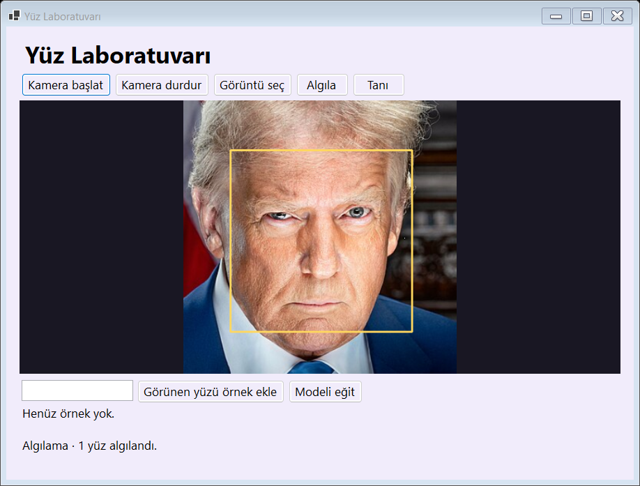
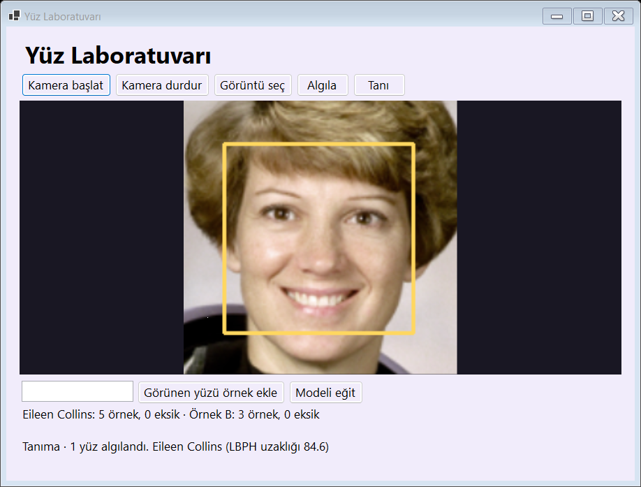

# Yüz Laboratuvarı

Kamera veya dosyada yüz algılama ve yerel örneklerle eğitilen bir modelle etiket tahmini.

## Teknoloji

C# / .NET 10, Windows Forms, [OpenCvSharp4.Windows 4.11.0.20250507](https://www.nuget.org/packages/OpenCvSharp4.Windows/4.11.0.20250507), Haar Cascade ve LBPH.

## Kurulum ve çalıştırma

Windows, Git ve .NET 10 SDK gerekir. Visual Studio kullanıyorsan **.NET masaüstü geliştirme** iş yükünü kur.

```powershell
git clone https://github.com/ayhamhammoud1/YMH219-FaceRecognition.git
cd YMH219-FaceRecognition
```

Model dosyası için aşağıdaki özellikler bölümündeki kurulum adımını uygula.

```powershell
dotnet restore
dotnet run
```

## Özellikler

- Windows x64 ve Visual C++ x64 çalışma zamanı gerekir.
- Aşağıdaki çalıştırma komutundan önce, model dosyası kaynakta yoksa [OpenCV 4.11 Haar Cascade dosyasını](https://raw.githubusercontent.com/opencv/opencv/4.11.0/data/haarcascades/haarcascade_frontalface_default.xml) proje klasörüne `haarcascade_frontalface_default.xml` adıyla kaydet. Derleme dosyayı uygulama klasörüne kopyalar.
- **Görüntü seç** veya **Kamera başlat** ile görüntü aç. **Algıla** yüzleri dikdörtgenle işaretler.
- Bir kişi için aynı etiketi kullan. Her seferinde tek yüz içeren farklı bir kare aç ve **Görünen yüzü örnek ekle** düğmesine bas. Liste kişi başına mevcut ve eksik örnek sayılarını gösterir.
- En az iki etiket için üçer örnek ekleyince **Modeli eğit** düğmesine bas. Ardından eğitimden ayrı bir görüntü aç ve **Tanı** düğmesini kullan.
- Örnekler ve eğitilen model bellekte tutulur. Kişisel fotoğrafları depo dışında tut.

## Ekran görüntüleri





## Sınırlamalar

LBPH uzaklığı bir yüzde değildir. Düşük değer daha yakın eşleşmeye karşılık gelir. Kullanılan eşik ders demosu içindir.

## Yerel test sonuçları

- **Algılama:** Donald Trump portresinde bir yüz bulundu. Trump ile yapılan ayrı tanıma denemelerinde model eğitimde kullanılmayan portreleri **Bilinmeyen** olarak işaretledi.
- **Tanıma:** İki etiketle eğitilen model, eğitimde kullanılmayan NASA fotoğrafında **Eileen Collins** etiketini verdi (LBPH uzaklığı 84,6, eşik 85). Bu tek deneme modelin genel doğruluğunu ölçmez. Canlı kamera doğrulanmadı.

Ekran görüntülerinde [Daniel Torok'un Ocak 2025 Donald Trump portresi](https://commons.wikimedia.org/wiki/File:January_2025_Official_Presidential_Portrait_of_Donald_J._Trump.jpg) ve [NASA'nın Eileen Collins fotoğrafı](https://scikit-image.org/docs/0.24.x/api/skimage.data.html#skimage.data.astronaut) kullanıldı. İki fotoğraf da kamu malıdır ve uygulama için kırpılıp yeniden boyutlandırıldı. Eğitim dosyaları ve üretilen model depoya eklenmedi. Haar Cascade dosyasının lisansı XML dosyasının başındadır.

## Öğrenci

Ayham Nawaf Hammoud — 240541613
