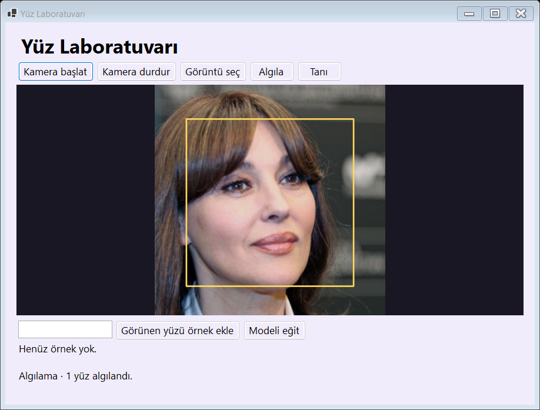
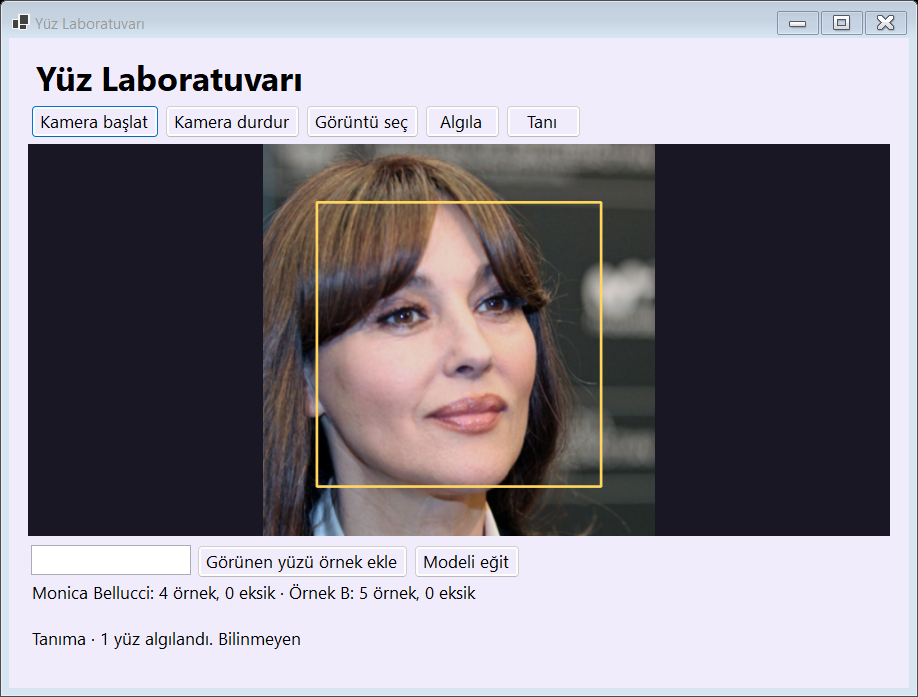

# Yüz Laboratuvarı

Kamera veya dosyada yüz algılama ve yerel örneklerle eğitilen bir modelle etiket tahmini.

## Teknoloji

C# / .NET 10, Windows Forms, [OpenCvSharp4.Windows 4.11.0.20250507](https://www.nuget.org/packages/OpenCvSharp4.Windows/4.11.0.20250507), Haar Cascade ve LBPH.

## Kurulum ve çalıştırma

Windows, Git ve .NET 10 SDK gerekir. Visual Studio kullanıyorsan **.NET masaüstü geliştirme** iş yükünü kur.

```powershell
git clone https://github.com/ayhamhammoud1/YMH219-FaceRecognition.git
cd YMH219-FaceRecognition
```

Model dosyası için aşağıdaki özellikler bölümündeki kurulum adımını uygula.

```powershell
dotnet restore
dotnet run
```

## Özellikler

- Windows x64 ve Visual C++ x64 çalışma zamanı gerekir.
- Aşağıdaki çalıştırma komutundan önce, model dosyası kaynakta yoksa [OpenCV 4.11 Haar Cascade dosyasını](https://raw.githubusercontent.com/opencv/opencv/4.11.0/data/haarcascades/haarcascade_frontalface_default.xml) proje klasörüne `haarcascade_frontalface_default.xml` adıyla kaydet. Derleme dosyayı uygulama klasörüne kopyalar.
- **Görüntü seç** veya **Kamera başlat** ile görüntü aç. **Algıla** yüzleri dikdörtgenle işaretler.
- Bir kişi için aynı etiketi kullan. Her seferinde tek yüz içeren farklı bir kare aç ve **Görünen yüzü örnek ekle** düğmesine bas. Liste kişi başına mevcut ve eksik örnek sayılarını gösterir.
- En az iki etiket için üçer örnek ekleyince **Modeli eğit** düğmesine bas. Ardından eğitimden ayrı bir görüntü aç ve **Tanı** düğmesini kullan.
- Örnekler ve eğitilen model bellekte tutulur. Kişisel fotoğrafları depo dışında tut.

## Ekran görüntüleri





## Sınırlamalar

LBPH uzaklığı bir yüzde değildir. Düşük değer daha yakın eşleşmeye karşılık gelir. Kullanılan eşik ders demosu içindir.

## Yerel test sonuçları

Model iki etiketle eğitildi. Monica Bellucci etiketi için dört fotoğraf, ikinci etiket için bir fotoğrafın beş farklı varyantı kullanıldı. Eğitimde kullanılmayan Monica Bellucci portresinde bir yüz algılandı ve model eşik içinde bir etiket bulamadığı için **Bilinmeyen** sonucunu verdi. Canlı kamera doğrulanmadı.

İki ekran görüntüsündeki portre, [Paul Katzenberger — Monica Bellucci San Sebastián](https://commons.wikimedia.org/wiki/File:Monica_Bellucci_San_Sebasti%C3%A1n.jpg) fotoğrafından kırpılıp yeniden boyutlandırıldı ve uygulamada dikdörtgenle işaretlendi. Fotoğraf ve bu ekran görüntüleri [CC BY-SA 4.0](https://creativecommons.org/licenses/by-sa/4.0/) lisansıyla paylaşılır. Eğitim dosyaları ve üretilen model depoya eklenmedi. Haar Cascade dosyasının lisansı XML dosyasının başındadır.

## Öğrenci

Ayham Nawaf Hammoud — 240541613
